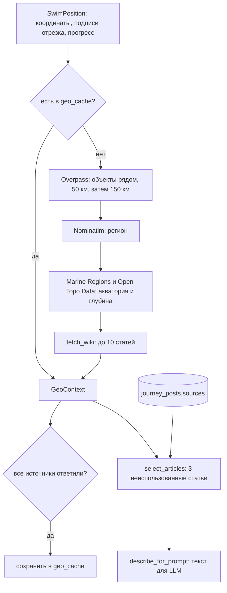

# Поиск информации о местности по координатам

Документ описывает, как бот превращает координаты виртуального пловца в текстовую справку, на которую опирается LLM при написании еженедельного поста о местности. Вся логика находится в [`geo_context.py`](geo_context.py), точка входа — `build_geo_context(position)`, текст для модели собирает `describe_for_prompt`.

## Коротко

1. По координатам пловца из OpenStreetMap (через Overpass API) берутся именованные объекты: мысы, заливы, проливы, острова, города, сёла. Вдали от берега добавляются подписи морей и океанов.
2. Через Nominatim определяется регион, через Marine Regions — акватория по классификации IHO («Японское море», «Тихий океан»), через Open Topo Data — глубина в точке.
3. Из Википедии подбирается до 10 статей-кандидатов, от самого надёжного источника к наименее надёжному: точные ссылки из OSM, статьи с координатами рядом с пловцом, поиск по названию с проверкой расстояния, статьи об акватории и регионе. Если русской статьи нет, берётся английская. От каждой статьи сохраняется до 2500 символов текста, включая разделы вроде «История».
4. Всё это собирается в объект `GeoContext` и кешируется в SQLite. В кеше лежат координаты объектов, а не готовые расстояния, поэтому расстояния и направления всегда считаются от текущей точки пловца.
5. Для поста выбираются 3 статьи, на которые ещё не опирались прошлые посты. Если таких нет, бот пишет короткий пост о прогрессе без новых фактов.

Ни один источник не обязателен. Если какой-то сервис не ответил, справка собирается из того, что удалось получить, а `build_geo_context` никогда не бросает исключение.



## Откуда берутся координаты

Позицию пловца считает `get_swim_position` в [`map_generator.py`](map_generator.py), та же функция используется для `/map`:

- из листа `МетрыV2` берётся накопленный метраж клуба (`Cumulative_sum`) на сегодня;
- из листа `Локации` выбирается текущий отрезок — первый, у которого `Cumul_dist` больше этого метража;
- доля пройденного отрезка откладывается вдоль прямой от `Start_point` к `Finish_point`, так получается точка пловца.

Для поиска информации о местности важны поля `SwimPosition`:

| Поле | Что это |
|---|---|
| `lat`, `lon` | Координаты пловца |
| `start_name`, `finish_name` | Подписи точек отрезка из `Start_caption` / `Finish_caption` |
| `finish_coord` | Координаты конца отрезка: от них считается остаток пути в справке |
| `description` | Текст из колонки `Description` листа `Локации` |
| `leg_travelled`, `leg_total` | Сколько метров клуба пройдено на отрезке и его длина в метрах клуба; в справку идёт только доля в процентах |
| `bearing` | Направление движения по отрезку в градусах |
| `leg_index` | Индекс строки отрезка в листе `Локации`; нужен только для ключа кеша |

Колонка `Distance` в листе может не совпадать с реальной длиной отрезка, поэтому в справке остаток пути — это географическое расстояние от пловца до `finish_coord` по прямой, а не разница метров клуба.

## Шаг 1. Объекты поблизости: Overpass API

Функция `fetch_nearby_objects`.

Overpass — API для выборок из базы OpenStreetMap. Бот отправляет один запрос из четырёх частей:

- `natural` = `cape`, `bay`, `peninsula`, `strait`, `volcano`, `reef` в радиусе поиска;
- `place` = `island`, `islet`, `archipelago` в радиусе поиска;
- `place` = `city`, `town` в радиусе поиска;
- `place` = `village` в радиусе не больше 20 км (`OVERPASS_VILLAGE_RADIUS_M`).

```
[out:json][timeout:60];
(
  nwr(around:50000,43.02,131.88)["natural"~"^(cape|bay|peninsula|strait|volcano|reef)$"]["name"];
  nwr(around:50000,43.02,131.88)["place"~"^(island|islet|archipelago)$"]["name"];
  nwr(around:50000,43.02,131.88)["place"~"^(city|town)$"]["name"];
  nwr(around:20000,43.02,131.88)["place"="village"]["name"];
);
out tags bb;
```

Лимита на число элементов нет. Раньше он был (300), а Overpass сортирует выдачу не по расстоянию, поэтому в густонаселённых местах ближайшие объекты могли не попасть в ответ. Сёла ищутся в меньшем радиусе, чтобы ответ оставался небольшим.

`out tags bb` возвращает для точек координаты, а для линий и отношений (остров, залив) — рамку (bounding box).

**Радиус.** Сначала 50 км. Если в этом радиусе ничего не нашлось (типично для открытого моря), запрос повторяется с радиусом 150 км.

**Моря и океаны.** Если ближайший объект дальше 50 км или объектов нет вовсе, отдельным запросом ищутся точки `place=sea|ocean` в радиусе 500 км. В справке они помечаются как «акватория» без расстояния: точка подписи моря ничего не говорит о близости к нему.

**Зеркала.** Overpass часто перегружен и отвечает 502 или по таймауту, поэтому бот по очереди пробует четыре сервера: `overpass-api.de`, `overpass.private.coffee`, `maps.mail.ru`, `overpass.kumi.systems`. Если не ответило ни одно, функция возвращает `None`: «Overpass недоступен», в отличие от пустого списка «рядом ничего нет».

**Обработка ответа.** Для каждого объекта:

- название: `name:ru`; если его нет — `name`, когда он написан кириллицей; затем `name:en`; затем `name` как есть. Английское название сохраняется отдельно (`name_en`) для поиска в английской Википедии;
- тип переводится на русский: `cape` → «мыс», `bay` → «залив», `town` → «город» и т.д.;
- запоминаются точка объекта, рамка (если есть) и теги `wikipedia` и `wikidata`;
- одинаковые пары «тип + название» схлопываются, остаётся ближайшая.

В кеш сохраняются 15 ближайших объектов (`NEARBY_STORE_LIMIT`), в справку попадают 8 ближайших к текущей точке (`NEARBY_LIMIT`).

**Расстояние до протяжённых объектов.** У линий и отношений расстояние считается не до центра, а до ближайшей точки рамки: координаты пловца прижимаются к её границам. Если пловец внутри рамки (например, в заливе Петра Великого), объект подписывается как «протяжённый объект, мы рядом». Без этого пловец у берега Сахалина получал бы «остров Сахалин (300 км)», потому что центр острова далеко.

**Подпись объекта.** Свойство `NearbyObject.label` склеивает тип и название: «остров Русский». Если название уже содержит географическое слово (русское или английское), тип не добавляется: «мыс Бугристый», «бухта Спокойная», «Cape Inubo».

## Шаг 2. Регион, акватория и глубина

**Регион: Nominatim** (`fetch_region`). Обратное геокодирование на русском с детализацией (`zoom`) 10, 8, 5, 3; берётся первый непустой ответ. Между запросами пауза в 1 секунду — этого требуют правила Nominatim. `None` означает, что Nominatim не ответил, пустая строка — что адреса нет (открытое море). Пример: `Приморский край, Дальневосточный федеральный округ, Россия`.

**Акватория: Marine Regions** (`fetch_sea_areas`). Сервис `getGazetteerRecordsByLatLong` возвращает все морские районы, в которые попадает точка. Бот берёт из них:

- море — первую запись типа `IHO Sea Area`, в названии которой нет «Ocean»; если таких нет (открытый океан), первую `IHO Sea Area` с «Ocean», например «North Atlantic Ocean»;
- океан — запись типа `Ocean`.

У одного района бывает несколько названий («Japan Sea/East Sea», «Sea of Japan»), поэтому русское название и статья Википедии ищутся через Wikidata. У объектов Wikidata есть свойство P3006 (Marine Regions ID): поиск `haswbstatement:P3006=<MRGID>` находит объект, а у него есть русская подпись («Японское море») и ссылка на статью.

**Глубина: Open Topo Data** (`fetch_depth`), набор данных GEBCO 2020. На суше возвращается `None`. Глубина не влияет на полноту справки: если сервис не ответил, справка кешируется без глубины.

## Шаг 3. Статьи Википедии

Функция `fetch_wiki` собирает до 10 статей-кандидатов (`WIKI_CANDIDATES_LIMIT`). Источники перебираются по порядку; каждый следующий добирает статьи, пока не набран лимит.

### 3.1. Точные ссылки из OSM (источник `osm`)

Функция `_titles_from_osm`.

- тег `wikipedia=ru:Русский (остров)` — заголовок русской статьи берётся напрямую;
- тег `wikidata=Q1230` — одним запросом к Wikidata (`wbgetentities`, `sitefilter=ruwiki|enwiki`) узнаётся заголовок статьи. Если русской статьи нет, берётся английская;
- тег `wikipedia=en:...` используется, только если через Wikidata ничего не нашлось.

Статьи упорядочиваются от ближайших объектов к дальним. Это самый надёжный источник: статья гарантированно о том самом объекте, а не о тёзке.

### 3.2. Wikipedia GeoSearch (источник `geosearch`)

Функция `_wiki_geosearch`. Запрос `generator=geosearch` возвращает до 20 статей с координатами в радиусе 10 км вместе со вступлением и длиной статьи. Статьи со вступлением короче 200 символов отбрасываются, остальные сортируются по длине статьи: так улицы, школы и отдельные здания уходят вниз, а наверх поднимаются статьи о городе, острове, бухте.

### 3.3. Поиск по названию (источник `search`)

**Список запросов** (`_search_queries`):

1. 4 ближайших объекта из шага 1 (без морей): по русской подписи в русской Википедии или, если русского названия нет, по `name_en` в английской;
2. названия точек текущего отрезка из листа `Локации`: сначала финиш, потом старт.

**Поиск одной статьи** (`_wiki_search_title`). Полнотекстовый поиск (`list=search`) и 5 первых результатов. Заголовок принимается, только если содержит первые 5 букв самого длинного слова запроса, не считая географических слов (`_title_matches`). Для «мыс Огородный» это «огоро».

**Гео-фильтр.** Статья принимается, только если у неё есть координаты и она не дальше 200 км от пловца (`WIKI_MAX_DISTANCE_KM`). Пример, из-за которого он появился: рядом с Владивостоком на острове Русский есть бухта Севастопольская. Поиск по её названию находил статью о крымской Севастопольской бухте в 7 000 км от пловца, и модель писала о Крыме. Теперь такая статья отбрасывается с причиной «7380 км от пловца».

### 3.4. Акватория (источник `sea`)

Статьи о море и океане из шага 2 (через Wikidata). В открытом океане это часто единственный материал.

### 3.5. Регион (источник `region`)

Поиск по первой части адреса Nominatim — самой конкретной (район, край). Здесь тоже есть гео-фильтр, но с большим порогом, 1500 км (`WIKI_REGION_MAX_DISTANCE_KM`): у крупного объекта координаты указывают на центр. Статья без координат принимается.

Отброшенные статьи пишутся в лог, а в блокноте их можно увидеть через параметр `rejected` функции `fetch_wiki`.

### Текст статей

`_wiki_pages` получает пачками по 20 заголовков вступление, координаты и длину (`prop=extracts|coordinates|info`, с редиректами). Затем для каждого кандидата `_wiki_full_text` получает полный текст (API отдаёт его только по одной статье за запрос). Из текста убираются служебные разделы («Примечания», «Ссылки», «Литература», «References» и т.п.), и он обрезается по границе абзаца или предложения до 2500 символов (`WIKI_EXTRACT_CHARS`).

Если Википедия отвечает «Search is currently too busy» или кодом 429/503, запрос повторяется дважды с паузой (`WIKI_BUSY_RETRIES`).

## Шаг 4. Сборка, кеш и обработка сбоев

Функция `build_geo_context`:

1. Строит ключ кеша: `v3:<leg_index>:<широта>:<долгота>`, координаты округлены до сетки 0,05° (около 5,5 км по широте). `v3` — версия формата: при изменении логики поиска версию повышают, и старые записи перестают использоваться.
2. Если запись есть в таблице `geo_cache`, возвращает её. Расстояния всё равно считаются от текущей точки, поэтому устаревших «3,4 км, СЗ» не бывает.
3. Иначе последовательно вызывает Overpass, Nominatim, Marine Regions, Open Topo Data и `fetch_wiki`. Источники, которые не ответили, записываются в `GeoContext.failed`.
4. Сохраняет результат в кеш, только если все источники ответили (кроме глубины) и известен регион или акватория (`is_complete`). Пустой список статей в открытом море — нормальный полный результат.

Отдельно `GeoContext.is_usable()` говорит, хватает ли справки для поста: Overpass ответил и известен регион или акватория. Если нет, планировщик в [`notifications.py`](notifications.py) переносит пост на следующий раунд (через 3 часа). В последнем раунде пост пишется по тому, что есть.

| Что упало | Что будет |
|---|---|
| Все зеркала Overpass | Нет объектов поблизости и ссылок из OSM; пост переносится на следующий раунд |
| Nominatim | Нет региона и статьи о регионе; в море акватория его заменяет |
| Marine Regions или Wikidata | Нет акватории или её русского названия |
| Википедия | Меньше статей или нет совсем; справка не кешируется |
| Open Topo Data | Нет строки о глубине |

## Шаг 5. Выбор статей и текст для промпта

`select_articles(context, used_titles)` отдаёт до 3 статей (`PROMPT_ARTICLES_LIMIT`), заголовков которых нет среди источников последних 26 постов (`db.get_used_sources`). Источники поста — это статьи, на которые модель сослалась в `facts`, они сохраняются в колонку `journey_posts.sources`. Так в «медленные» недели, когда клуб остаётся в той же клетке, модель получает другие статьи из того же пула.

Если неиспользованных статей нет, пост пишется по отдельному промпту (`EXHAUSTED_SYSTEM_PROMPT`): короткий текст о том, где мы и сколько осталось, без исторических фактов.

`describe_for_prompt` превращает `GeoContext` в текстовый блок. Пример для точки у Находки:

```
Координаты пловца: 42.682, 133.218.
Отрезок маршрута: от «Находка» к «мыс Поворотный», пройдено 15% отрезка, до «мыс Поворотный» осталось 24,9 км по прямой, направление движения: ЮВ.
Регион (по данным OpenStreetMap): Приморский край, Дальневосточный федеральный округ, Россия.
Акватория: Японское море, Тихий океан. Глубина в точке: около 76 м.
Объекты поблизости: мыс Зелёный (3,4 км, СЗ); мыс Бугристый (3,4 км, С); бухта Спокойная (4,3 км, СЗ); ...
Статьи Википедии (источник — заголовок статьи):
- «Находка» (6,4 км от пловца): Нахо́дка — город в Приморском крае России. ...
- «Залив Петра Великого» (мы рядом): ...
```

Строки начинаются с названий служебных источников («описание отрезка», «регион», «акватория», «объекты поблизости»), на которые модель может ссылаться в `facts[*].source` наравне с заголовками статей. У английских статей есть пометка «на английском», пост модель пишет по-русски.

## Что происходит дальше

Справка используется в двух запросах к LLM ([`notifications.py`](notifications.py)):

1. **Генерация поста.** Модель возвращает JSON `{"text": ..., "facts": [{"fact": ..., "source": ...}]}`. Ответ, который не разобрался как JSON, а также слишком короткий (меньше 300 символов), слишком длинный (больше 1500) или со служебной разметкой текст отбрасываются; запрос повторяется один раз, затем раунд считается неудачным. Сырой ответ модели в чат не уходит.
2. **Программная проверка источников.** Каждый `source` должен совпасть с заголовком статьи из справки или с одним из служебных разделов. Факты без такого источника передаются проверяющему отдельным списком «убрать из поста».
3. **Проверка фактов.** Второй запрос получает справку, пост и факты с источниками. Всё, чего нет в справке, считается недостоверным, даже если кажется общеизвестным. Исправленный текст проходит ту же проверку формата. Если проверка не ответила, пост уходит без неё, только когда у всех фактов есть источник, и админы получают уведомление; иначе раунд считается неудачным.
4. Под постом добавляется строка «По материалам Википедии» со ссылками на статьи-источники (сообщение уходит с `parse_mode=HTML`, без превью ссылок).

## Настройки

Константы находятся в начале [`geo_context.py`](geo_context.py) и [`notifications.py`](notifications.py).

| Константа | Значение | Смысл |
|---|---|---|
| `OVERPASS_URLS` | 4 сервера | Зеркала Overpass в порядке перебора |
| `OVERPASS_RADII_M` | 50 000, 150 000 | Радиусы поиска объектов, второй — если в первом пусто |
| `OVERPASS_VILLAGE_RADIUS_M` | 20 000 | Радиус поиска сёл |
| `OVERPASS_SEA_RADIUS_M` | 500 000 | Радиус поиска подписей морей и океанов вдали от берега |
| `NEARBY_STORE_LIMIT` / `NEARBY_LIMIT` | 15 / 8 | Сколько объектов хранится в кеше / попадает в справку |
| `NOMINATIM_ZOOMS` | 10, 8, 5, 3 | Детализация обратного геокодирования |
| `WIKI_GEOSEARCH_RADIUS_M` | 10 000 | Радиус GeoSearch (максимум API) |
| `WIKI_MIN_INTRO_CHARS` | 200 | Минимальная длина вступления для статей из GeoSearch |
| `WIKI_CANDIDATES_LIMIT` | 10 | Сколько статей-кандидатов собирается для клетки |
| `PROMPT_ARTICLES_LIMIT` | 3 | Сколько статей попадает в один пост |
| `WIKI_EXTRACT_CHARS` | 2500 | Длина текста статьи |
| `WIKI_MAX_DISTANCE_KM` | 200 | Порог гео-фильтра для поиска по названию |
| `WIKI_REGION_MAX_DISTANCE_KM` | 1500 | Порог гео-фильтра для статьи о регионе |
| `CACHE_VERSION` | `v3` | Версия формата кеша |
| `CACHE_GRID_DEG` | 0,05 | Шаг сетки для ключа кеша, в градусах |
| `HTTP_TIMEOUT` | 15 с, 90 с | Таймауты подключения и ответа для всех внешних запросов |
| `USED_SOURCES_POSTS` | 26 | Сколько последних постов учитывается при отборе неиспользованных статей |
| `POST_MIN_CHARS` / `EXHAUSTED_MIN_CHARS` / `POST_MAX_CHARS` | 300 / 150 / 1500 | Допустимая длина текста поста |

Чтобы искать другие типы объектов (например, маяки или порты), достаточно добавить теги OSM в `NATURAL_KINDS` или `ISLAND_KINDS` вместе с русским названием типа. Для тегов из других ключей (`man_made=lighthouse`, `harbour=*`) понадобится добавить строку в `_overpass_query`.

## Внешние сервисы

| Сервис | Для чего | Ограничения |
|---|---|---|
| Overpass API (OpenStreetMap) | Объекты поблизости и их ссылки на Википедию | Часто перегружен, поэтому зеркала |
| Nominatim (OpenStreetMap) | Регион | Не больше 1 запроса в секунду, обязателен `User-Agent` |
| Marine Regions | Акватория по IHO | Без ключа |
| Open Topo Data (GEBCO 2020) | Глубина | 1 запрос в секунду, 1000 в сутки |
| Wikidata API | Статья по идентификатору из OSM и Marine Regions, русские названия акваторий | Без ключа |
| MediaWiki API ru/en.wikipedia.org | GeoSearch, поиск, тексты и координаты статей | Иногда отвечает «too busy», есть повторы |

Все сервисы бесплатные. Типичное время сбора справки без кеша — от 1 до 5 минут; основная задержка обычно в Overpass.

## Как посмотреть каждый шаг вживую

Блокнот [`journey_playground.ipynb`](journey_playground.ipynb) выполняет пайплайн по шагам для заданных координат и работает с отдельной базой `data/notebook_playground.db`. После этих изменений сигнатуры функций поменялись (`fetch_wiki` принимает акватории, `describe_for_prompt` — список статей, расстояния считаются методами объектов), поэтому ячейки блокнота нужно обновить.

Админская команда `/digest_preview` присылает в личку справку с выбранными статьями, список не ответивших источников, факты поста с источниками и замечания проверки.

Тесты чистых функций (подписи, расстояния до рамки, гео-фильтр, разбор ответов модели, проверка источников) лежат в `tests/` и запускаются командой `python -m pytest`.

## Известные ограничения

- **У мелких объектов нет ссылок.** У мелких мысов и бухт нет тегов `wikipedia`/`wikidata`, поэтому вблизи берега часто срабатывает только поиск по названию.
- **Рамка — грубое приближение.** Для изогнутых объектов (дугообразный залив, архипелаг) пловец может оказаться внутри рамки, хотя до самого объекта далеко. Тогда в справке будет «мы рядом».
- **Неточное совпадение заголовка.** Проверка по первым 5 буквам может пропустить тёзку с координатами ближе 200 км или статью-неоднозначность с координатами.
- **Кеш не устаревает.** Полная справка для клетки сетки используется всегда, пока не повысят `CACHE_VERSION`.
- **Модель может сослаться не на тот источник.** Программная проверка ловит только несуществующие источники; соответствие факта статье проверяет вторая модель.
